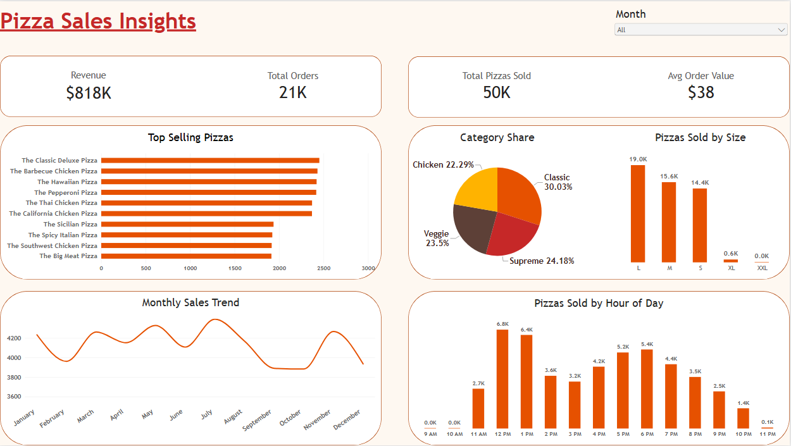

# 🍕 Pizza Sales Dashboard (Power BI)

An interactive Power BI dashboard that analyses pizza sales: revenue, orders, best sellers, category and size mix, and peak ordering hours.


📄 [View the dashboard as a PDF](Pizza_Sales_Dashboard.pdf)

## Key metrics
| Metric | Value |
|---|---|
| Total Revenue | $818K |
| Total Orders | 21K |
| Total Pizzas Sold | 50K |
| Average Order Value | $38 |

## Dataset
Four related tables:
- `orders`: order date and time
- `order_details`: pizzas and quantity in each order
- `pizzas`: pizza size and price
- `pizza_types`: pizza name, category and ingredients

## Dashboard features
- KPI cards for revenue, orders, pizzas sold and average order value
- Month slicer that filters every visual
- Top 10 pizzas by quantity sold
- Category share (pie chart) and pizzas sold by size
- Monthly sales trend and pizzas sold by hour of day
- Custom orange, red and brown theme

## Key DAX measures
```dax
Revenue =
SUMX(
    order_details,
    order_details[quantity] * RELATED(pizzas[price])
)

Total Orders = DISTINCTCOUNT(order_details[order_id])
Total Pizzas Sold = SUM(order_details[quantity])
Avg Order Value = DIVIDE([Revenue], [Total Orders])
```

## Key insights
1. **Two daily rushes.** Sales peak at lunch (12-1 PM, about 6.8K and 6.4K pizzas) and again in the evening (5-6 PM, about 5.2K and 5.4K). Staffing and prep should be concentrated in these windows.
2. **Best seller by quantity is not the top earner.** The Classic Deluxe Pizza sells the most pizzas, while the Thai Chicken Pizza leads on revenue. Price matters as much as volume.
3. **Classic is the biggest category** at about 30% of sales, followed by Supreme (24%), Veggie (23.5%) and Chicken (22%). The mix is fairly balanced.
4. **Large pizzas dominate.** L sells about 19K pizzas, ahead of M (15.6K) and S (14.4K), while XL and XXL are almost negligible and could be reviewed for removal from the menu.
5. **Sales are steady across the year**, with a peak in July and a dip around September and October.

## Business recommendations

1. **Staff and prep for the two daily rushes.** Demand peaks at 12-1 PM and 5-6 PM, so extra kitchen and delivery staff, and dough and toppings prepared in advance, would cover the busiest hours.
2. **Run offers in the quiet hours.** Sales are low from 2-4 PM and after 8 PM, so a mid-afternoon or late-evening deal could move demand into slower periods.
3. **Review the XL and XXL sizes.** Together they sell well under 1K pizzas out of 50K. Removing or simplifying them would cut inventory and menu complexity with little impact on sales.
4. **Feature the Thai Chicken Pizza.** It is the top revenue earner, so it deserves prominent placement in menus, combos and promotions. Pizzas that sell the most by quantity, like the Classic Deluxe, can anchor value bundles.
5. **Use promotions in the slower months.** Sales are highest in July and dip around September and October. The monthly swing is modest, so small seasonal offers are enough.

*These recommendations are based on one year of sales data and should be tested against costs and margins before acting on them.*

## Tools used
Power BI Desktop, DAX, data modelling

## How to open
Download `Pizza_Sales_Dashboard.pbix` and open it in Power BI Desktop.

